# kapOS System Architecture & Engineering Blueprint

This document specifies the technical architecture, design principles, modular feature layout, and component conventions of **kapOS** (`vaibos-nextjs`). It serves as the single source of truth for maintainers, contributors, and future development.

---

## 1. High-Level Architectural Vision

`kapOS` is a client-side operating system simulation built on top of **Next.js 14 (App Router)**, **React 18**, **TypeScript**, and **Tailwind CSS**. It bridges the gap between an immersive desktop GUI experience and a content-rich developer portfolio.

### Core Architectural Axioms
1. **Feature-Based Architecture (FBA)**: All business logic, state, components, and assets are partitioned by domain feature rather than technical layer.
2. **Encapsulation & Public API Boundaries**: Each feature exposes a strictly controlled public API via its root `index.ts`. Deep imports into another feature's internal folders (`components/`, `data/`, `utils/`) are forbidden.
3. **Declarative State Machines**: All OS capabilities (window stacking, dragging, maximizing, minimizing, keyboard navigation) are modeled as deterministic state transitions in React context rather than raw DOM manipulations.
4. **Separation of Shell vs. Applications**: The desktop environment (`MenuBar`, `Dock`, `Widgets`, `Spotlight`) is decoupled from the user-space applications (`Terminal`, `Portfolio`, `Monitor`, `Resume`, etc.) through the centralized `WindowManagerContext`.
5. **Component Granularity (Rule of 150 Lines)**: Large, monolithic components are split into single-responsibility presentational units, custom hooks, and pure utilities.

---

## 2. System Architecture & Component Interaction

```mermaid
graph TD
    AppRouter["Next.js App Router (src/app/page.tsx)"] --> Desktop["Desktop Shell (src/features/desktop)"]
    Desktop --> WindowManagerProvider["WindowManagerProvider (src/features/window-manager)"]
    
    subgraph Desktop Environment
        Desktop --> Wallpaper["Wallpaper & Ambient Shaders"]
        Desktop --> MenuBar["MenuBar (Status, Clock, Spotlight Trigger)"]
        Desktop --> Dock["Magnified Dock (Framer Motion Physics)"]
        Desktop --> DesktopWidgets["Desktop Widgets (Weather, Calendar, Stats)"]
        Desktop --> DesktopIcons["Desktop Shortcuts"]
        Desktop --> Spotlight["Spotlight Search (Cmd+K)"]
        Desktop --> MobileHome["Mobile Home Grid (max-width: 720px)"]
    end

    subgraph Window Manager Subsystem
        WindowManagerProvider --> WindowLayer["WindowLayer (z-index Stacking & AnimatePresence)"]
        WindowLayer --> WindowInstance["Window (Draggable, Resizable, Controls)"]
        WindowInstance --> WindowTitleBar["WindowTitleBar (TrafficDots, App Icon, Title)"]
        WindowInstance --> WindowResizeHandle["WindowResizeHandle"]
        WindowInstance --> AppContent["App Container"]
    end

    subgraph Feature Applications
        AppContent --> AppPortfolio["Portfolio (3D R3F Scenes, Bento, Journey)"]
        AppContent --> AppTerminal["Terminal (Command Engine, History, Typewriter)"]
        AppContent --> AppMonitor["Developer Monitor (Telemetry, Heatmap, Radar)"]
        AppContent --> AppBlogs["Blogs (Article Explorer & Markdown Reader)"]
        AppContent --> AppProjects["Projects (File Explorer Simulation)"]
        AppContent --> AppExperience["Experience (Git Commit Log Tree)"]
        AppContent --> AppAbout["About (Explorer Tabs: Code, Photo, Skills)"]
        AppContent --> AppResume["Resume (Markdown & PDF Preview Engines)"]
        AppContent --> AppContact["Contact (Mail Client Simulation)"]
        AppContent --> AppSettings["Settings (Accent Theme, Blur, Font)"]
        AppContent --> AppThought["Thought Process (Engineering Methodology)"]
    end

    subgraph Shared Design System
        AppContent --> UIPrimitives["src/components/ui (Button, Badge, Toggle, CButton)"]
        AppContent --> MarkdownEngine["src/features/markdownPreview (Shiki, Mermaid, GFM)"]
    end
```



---

## 3. Directory Layout Blueprint

The codebase adheres strictly to the following tree organization:

```text
src/
├── app/                        # Next.js 14 App Router routes, metadata, and root styles
│   ├── globals.css             # Tailwind layers, custom CSS variables, glassmorphism tokens
│   ├── layout.tsx              # Root HTML layout, font variables, and open-graph metadata
│   ├── loading.tsx             # Route suspense fallback
│   ├── not-found.tsx           # Custom 404 handler
│   └── page.tsx                # Entry point rendering Desktop or direct Mobile view
│
├── components/                 # Global, cross-cutting shared components
│   ├── common/                 # Application-wide UI (BootScreen, SectionLabel)
│   └── ui/                     # Design system primitives (Button, Badge, Toggle, CButton)
│       └── index.ts            # Public export barrel for UI primitives
│
├── constants/                  # Global immutable configurations
│   ├── apps.ts                 # AppId union, APP_REGISTRY, DOCK_APPS, DESKTOP_APPS
│   ├── dev.ts                  # Developer profile constants (socials, bio, experience)
│   └── index.ts                # Public export barrel
│
├── hooks/                      # Shared global React hooks
│   ├── useClock.ts             # Live clock updater
│   ├── useMediaQuery.ts        # Dynamic CSS media query listener
│   ├── useMobile.ts            # Responsive mobile viewport detection
│   └── index.ts                # Public export barrel
│
├── lib/                        # Low-level utilities
│   └── utils.ts                # Tailwind clsx + twMerge utility (`cn`)
│
└── features/                   # Autonomous Domain Feature Modules
    ├── about/                  # Developer profile & tabbed explorer
    ├── blogs/                  # Technical articles & blog viewer
    ├── contact/                # Mail composer & social channels
    ├── desktop/                # OS desktop shell, menu bar, dock, widgets, wallpaper
    ├── experience/             # Git-style interactive career log
    ├── markdownPreview/        # Rich Markdown, Shiki syntax highlighter, Mermaid graphs
    ├── monitor/                # System performance & telemetry simulator
    ├── portfolio/              # 3D interactive portfolio showcase
    ├── projects/               # File explorer portfolio showcase
    ├── resume/                 # Dual Markdown/PDF interactive resume viewer
    ├── settings/               # System preference manager (accents, fonts, blur)
    ├── terminal/               # Interactive CLI shell simulator
    ├── thoughtProcess/         # Architectural thought process viewer
    └── window-manager/         # Centralized multi-window state & layer manager
```

---

## 4. Feature Module Anatomy & Standard

Every feature module inside `src/features/<feature-name>/` follows an identical, predictable anatomy:

```text
src/features/<feature-name>/
├── components/                 # Feature-specific components
│   ├── SubComponentA.tsx       # Decomposed presentational unit
│   ├── SubComponentB.tsx       # Decomposed presentational unit
│   └── <FeatureName>.tsx       # Top-level feature container / screen
├── hooks/                      # Feature-specific custom hooks (optional)
│   └── use<FeatureName>.ts     # State management & lifecycle logic
├── data/                       # Static datasets or mock stores (optional)
│   └── <featureName>.ts        # Type-safe datasets
├── types/ or types.ts          # Feature-scoped TypeScript definitions
├── utils/                      # Feature-scoped pure utility functions (optional)
└── index.ts                    # Public API Contract (barrel export)
```

### Module Boundary Rules
> [!IMPORTANT]
> - **Never deep-import across features**:
>   - ❌ Bad: `import { BlogDetail } from "@/features/blogs/components/BlogDetail";`
>   - ✅ Good: `import { BlogsWindow, Blog } from "@/features/blogs";`
> - **The `index.ts` file is the sole public contract** of the feature. Only re-export what external consumers legitimately need.
> - **Self-containment**: A feature should be deleteable or movable with minimal edits to other modules (only the window registry needs updating).

---

## 5. Decomposed Feature Specifications

### 5.1 Window Manager (`src/features/window-manager`)
The core orchestrator of the simulated desktop operating system.
- **`WindowManagerContext.tsx`**: Maintains the global window table (`windows: Record<string, WindowState>`), active focus order (`openOrder: AppId[]`), and the highest z-index counter.
- **`layout.ts`**: Pure calculation helper determining cascading offsets for new windows (`nextRect`).
- **`Window.tsx`**: Window shell component coordinating motion animations, z-index focus, and container styling.
- **`WindowTitleBar.tsx`**: Desktop title bar rendering app icon, title, and pointer drag listener.
- **`TrafficDots.tsx`**: macOS-styled traffic light controls (close, minimize, maximize) with active hover glyphs.
- **`WindowResizeHandle.tsx`**: Bottom-right resize handle binding touch/pointer events.
- **`WindowLayer.tsx`**: Canvas overlay wrapped in Framer Motion's `<AnimatePresence mode="popLayout">` that renders active windows.

#### Window Lifecycle State Machine
```
[Unopened] ──(openWindow)──> [open] <──(restoreWindow)── [minimized]
                                │                              ▲
                        (minimizeWindow)               (finalizeMinimize)
                                │                              │
                                └──> [minimizing] ─────────────┘
                                │
                          (closeWindow)
                                │
                                └──> [closing] ──(finalizeClose)──> [Unopened (deleted)]
```

---

### 5.2 Desktop Environment (`src/features/desktop`)
Provides the operating system chrome and system controls.
- **`Desktop.tsx`**: Coordinates the boot sequence (`BootScreen`), responsive viewport switching, and initial desktop windows launch.
- **`Dock.tsx` & `DockItem.tsx`**: Physics-based floating dock utilizing `useSpring` and `useTransform` to simulate macOS cursor magnification (scaling from 48px to 72px based on cursor proximity).
- **`DesktopWidgets.tsx`**:
  - `WeatherWidget.tsx`: Live weather fetching via Open-Meteo REST API (`useWeather`).
  - `CalendarWidget.tsx`: Real-time calendar grid with current date highlighting.
  - `QuickStatsWidget.tsx`: Live recruitment status and experience highlights.
- **`Spotlight.tsx`**: Global system search palette (triggered via `⌘K` or click), providing keyboard-navigable app launching.
- **`Wallpaper.tsx` & `AuroraBackground.tsx`**: Multi-layer procedural ambient background rendered using Three.js and custom GLSL vertex/fragment noise shaders.
- **`MobileHome.tsx`, `MobileStatusBar.tsx`, `MobileNavBar.tsx`**: Dedicated touch-optimized interface rendered automatically on viewports `< 720px`.

---

### 5.3 Interactive Terminal (`src/features/terminal`)
Simulates an interactive zsh-style developer CLI.
- **`useTerminal.ts`**: Pure hook managing command execution, history buffer (Up/Down arrow memory), line generation, and terminal state.
- **`TerminalHeader.tsx`**: Shell welcome message and help prompt.
- **`TerminalLine.tsx`**: Renders input prompts (`➜ ~`), link responses, error highlights, and typewriter output.
- **`TerminalPrompt.tsx`**: Controlled input field with auto-scroll and blinking block cursor (`▋`).
- **`commands.ts`**: Built-in command registry (`help`, `about`, `skills`, `projects`, `resume`, `neofetch`, `clear`, `github`, `linkedin`, `email`).

---

### 5.4 Developer Monitor (`src/features/monitor`)
Simulates real-time developer telemetry and workstation activity.
- **`SystemOverview.tsx` & `SystemCard.tsx`**: Hardware utilization meters (CPU, RAM, Active Projects, Commits) with animated percentage bars.
- **`TechRadar.tsx`**: Primary technical competencies mapped to competency percentages.
- **`RecentActivity.tsx`**: Visual commit and deployment pipeline log.
- **`ContributionGraph.tsx`**: GitHub-style 52-week contribution heatmap generated via `buildHeatmap()`.
- **`data/stats.ts`**: Configurable developer system metrics.

---

### 5.5 Portfolio Showcase (`src/features/portfolio`)
A comprehensive, responsive developer showcase with 3D WebGL scenes.
- **`PortfolioPage.tsx`**: Assembles the complete portfolio page with ambient light rays, sticky navigation, and smooth scroll anchors.
- **`components/hero/`**:
  - `HeroStats.tsx`: Interactive stat cards (Years, Projects, Passion).
  - `HeroTiltCard.tsx`: 3D perspective mouse-tilt card featuring profile imagery.
- **`components/journey/`**:
  - `JourneyCard.tsx`: Glassmorphism timeline card with rotating conic gradient border.
  - `JourneyTimelineDot.tsx`: Pulse glowing connector node.
- **`components/three/`**: WebGL Canvas scenes powered by `@react-three/fiber` and `@react-three/drei` (`HeroScene`, `JourneyScene`, `AboutScene`, `ProjectScene`).
- **`components/common/`**: Visual effect primitives (`LightRays`, `SideRays`, `SpecularButton`, `CircularGallery`, `MagicBento`, `ScrollStack`, `LogoLoop`).

---

### 5.6 Content Applications (`about`, `experience`, `projects`, `resume`, `blogs`, `contact`, `settings`, `thoughtProcess`)
- **`about`**: Code, photo, skills, and contact tabs powered by `AboutSidebar` and `MarkdownPreviewFile`.
- **`experience`**: Interactive Git commit log (`ExperienceCommitNode`, `ExperienceBranchNode`).
- **`projects`**: File-explorer style project showcase with `ProjectBreadcrumb`, `ProjectFolderGrid`, and `ProjectReadme`.
- **`resume`**: Dual-view resume with instant markdown download, PDF preview, and native browser print hookup (`ResumeToolbar`, `ResumePdfView`, `ResumeMarkdownView`).
- **`blogs`**: Article explorer with live text search and markdown rendering (`BlogSidebar`, `BlogDetail`).
- **`contact`**: Mail client interface with interactive field validation and instant feedback.
- **`settings`**: Accent theme engine updating root CSS variables (`--accent`, `--accent-2`), glass blur toggle, and monospace font switcher.
- **`thoughtProcess`**: Direct viewer for software engineering methodologies and architecture notes.

---

## 6. How to Add a New Application / Window

Follow this step-by-step checklist to introduce a new feature application into `kapOS`:

### Step 1: Create the Feature Module
Create `src/features/my-new-app/`:
```text
src/features/my-new-app/
├── components/
│   └── MyNewApp.tsx
├── types.ts
└── index.ts
```

In `src/features/my-new-app/components/MyNewApp.tsx`:
```tsx
"use client";

export function MyNewApp() {
  return (
    <div className="p-6 text-white">
      <h2 className="text-xl font-bold">My New Application</h2>
      <p className="mt-2 text-sm text-[var(--text-2)]">Application content here...</p>
    </div>
  );
}

export default MyNewApp;
```

In `src/features/my-new-app/index.ts`:
```ts
export { MyNewApp, default } from "./components/MyNewApp";
export * from "./types";
```

### Step 2: Register the App in `src/constants/apps.ts`
1. Add the app ID to `AppId`:
```ts
export type AppId =
  | "about"
  | "experience"
  | ...
  | "myNewApp";
```
2. Add metadata to `APP_REGISTRY`:
```ts
myNewApp: {
  id: "myNewApp",
  title: "My New App",
  icon: Sparkles, // from 'lucide-react'
  accent: "#EC4899",
  width: 700,
  height: 500,
},
```
3. (Optional) Add `"myNewApp"` to `DOCK_APPS` or `DESKTOP_APPS`.

### Step 3: Mount in `WindowLayer.tsx`
In `src/features/window-manager/components/WindowLayer.tsx`:
```tsx
import { MyNewApp } from "@/features/my-new-app";

const APP_CONTENT: Record<AppId, React.ComponentType> = {
  ...
  myNewApp: MyNewApp,
};
```

Your app is now fully integrated with:
- Window dragging, resizing, maximizing, and minimizing
- Stacking order (z-index focus)
- Spotlight search discovery (`⌘K`)
- Dock magnification launcher
- Mobile home grid launcher

---

## 7. Component Sizing & Clean Code Principles

| Principle | Guideline |
| :--- | :--- |
| **Max File Length** | Target **< 150 lines** for UI components. Exceeding 200 lines indicates mixed concerns that must be decomposed into subcomponents or hooks. |
| **Hook Extraction** | Any component with complex `useEffect` timers, DOM measurements, or state machines must extract them into a dedicated `hooks/use<Name>.ts`. |
| **Zero Inline Logic** | Business logic (filtering, calculations, API fetching) belongs in `utils/` or custom hooks, keeping JSX purely declarative. |
| **Type Safety** | No `any` types. Strict typing on all props, states, and callback handlers. |
| **Styling Consistency** | Use Tailwind CSS utility classes and semantic CSS variables (`var(--text-1)`, `var(--accent)`, `var(--glass)`). |

---

## 8. Verification & Build Workflow

- **Type Check**:
  ```bash
  npx tsc --noEmit
  ```
- **Lint Check**:
  ```bash
  npm run lint
  ```
- **Production Build**:
  ```bash
  npm run build
  ```
