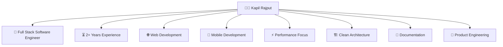
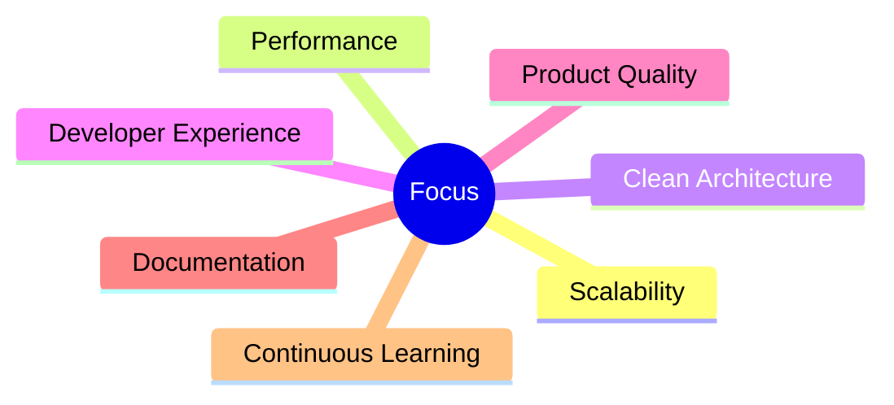

# 👋 Hi, I'm Kapil Rajput

> **Full Stack Software Engineer** specializing in modern web and mobile applications, scalable backend systems, and developer-focused architecture.

**React • Next.js • React Native • Node.js • TypeScript • MongoDB • Elasticsearch • Docker**

---

# 🚀 About Me

I'm a **Full Stack Software Engineer** with **2+ years of professional experience** building production-ready web and mobile applications.

I enjoy turning ideas into reliable software—from crafting intuitive user interfaces to designing scalable backend systems and maintaining clean, well-documented codebases.

My focus is on building applications that are:

- ⚡ Fast and performant
- 🏗 Scalable and maintainable
- 📱 User-friendly across platforms
- 🔒 Secure and reliable
- 📖 Well documented and easy to extend

I believe that great software comes from balancing technical excellence with a strong understanding of product goals and user needs.

---

# 👨‍💻 Engineering Snapshot

---

# 💼 What I Do

- 🌐 Build modern web applications
- 📱 Develop cross-platform mobile applications
- 🔥 Design scalable backend services and REST APIs
- 🏗 Create reusable and maintainable architectures
- ⚡ Optimize application performance
- 📖 Write technical documentation and engineering guides
- 🚀 Deliver end-to-end product features from concept to deployment

---

# 🎯 My Engineering Focus

---

# ❤️ Engineering Philosophy

> **Write code that is easy to understand, maintain, and extend.**

> **Performance should be part of the design, not an afterthought.**

> **Documentation is a feature of great software.**

> **Simple, clean solutions scale better than unnecessary complexity.**

> **Continuous learning leads to continuous improvement.**

---

### ⭐ Building scalable software with clean architecture and great developer experience.

_"Great software is built one thoughtful commit at a time."_

