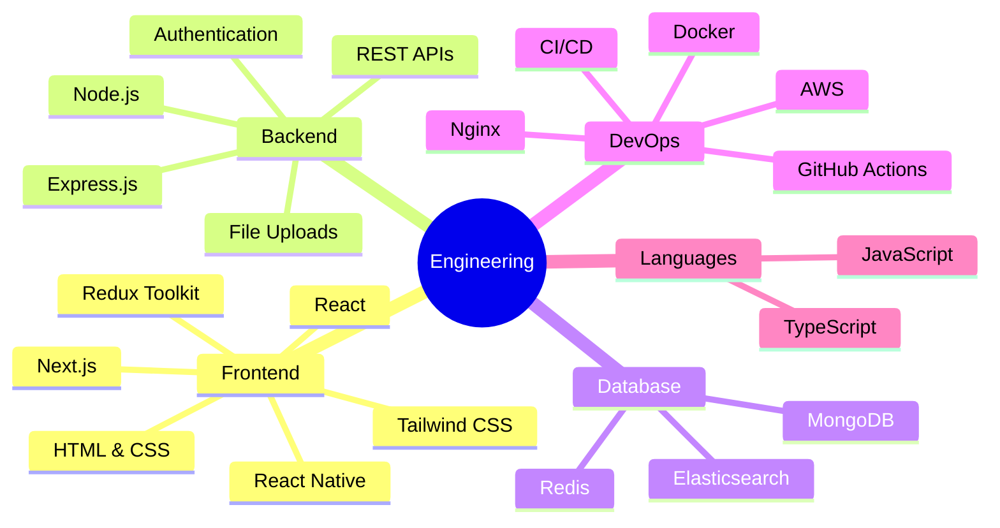
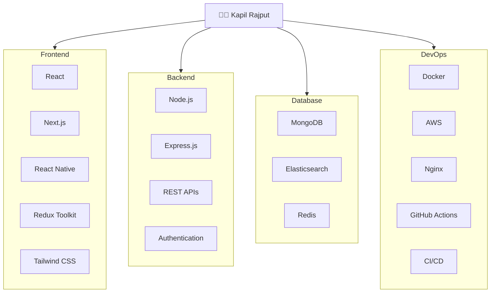
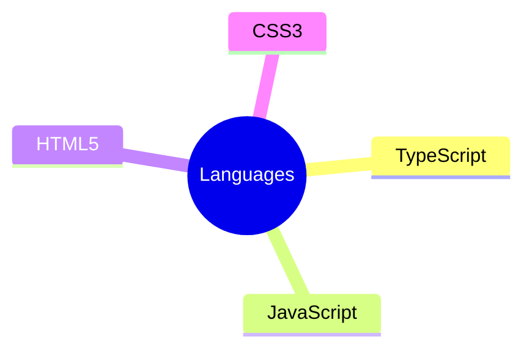
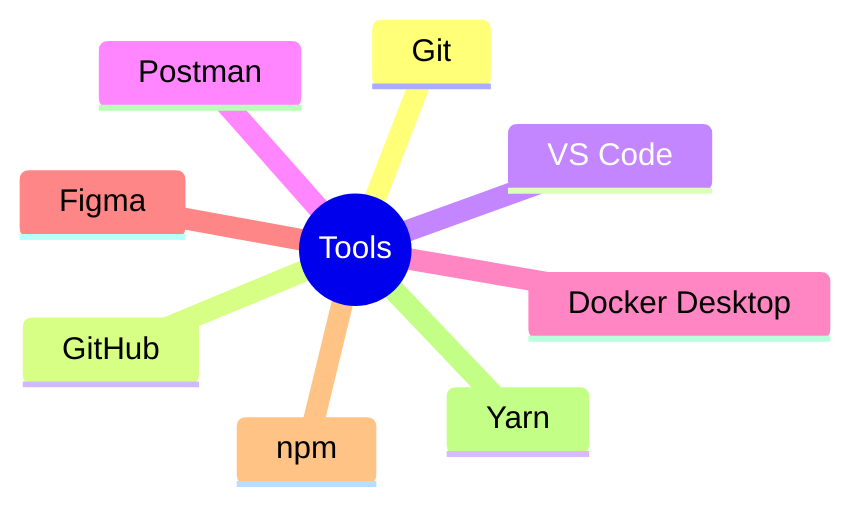
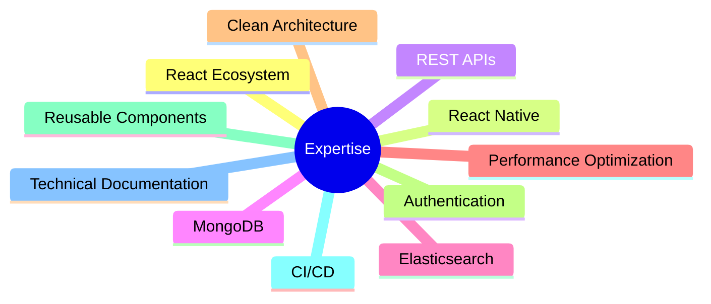

# 🛠️ Technical Skills

> Technologies I use to build scalable, maintainable, and high-performance applications.

---

## 🧠 Engineering Overview

---

## 🏗 Technology Architecture

---

## 💻 Languages

---

## ⚛️ Frontend

- React
- Next.js
- React Native
- Redux Toolkit
- Tailwind CSS
- HTML5
- CSS3

### Expertise

- Responsive UI Development
- Component-Based Architecture
- State Management
- Server-Side Rendering (SSR)
- Static Site Generation (SSG)
- Mobile Application Development

---

## 🔥 Backend

- Node.js
- Express.js
- REST APIs
- JWT Authentication
- Multer
- File Uploads

### Expertise

- Authentication & Authorization
- API Design
- Request Validation
- Error Handling
- Middleware Development
- File Processing

---

## 🗄 Database & Search

- MongoDB
- Elasticsearch
- Redis

### Expertise

- Schema Design
- Aggregation Pipelines
- Full-text Search
- Index Optimization
- Caching
- Session Management

---

## ☁️ DevOps & Cloud

- Docker
- AWS
- Nginx
- GitHub Actions
- CI/CD

### Expertise

- Containerization
- Reverse Proxy
- Automated Deployment
- Build Pipelines
- Environment Configuration

---

## 🧰 Development Tools

---

## 🚀 Engineering Workflow

---

## 📈 Core Expertise

---

## 🎯 Engineering Principles

- ⚡ Performance First
- 🏗 Scalable Architecture
- 📦 Reusable Components
- 🔒 Secure API Design
- 📱 Responsive & Mobile-First Development
- 📖 Documentation-Driven Development
- 🧪 Quality Through Testing
- 🚀 Continuous Improvement
